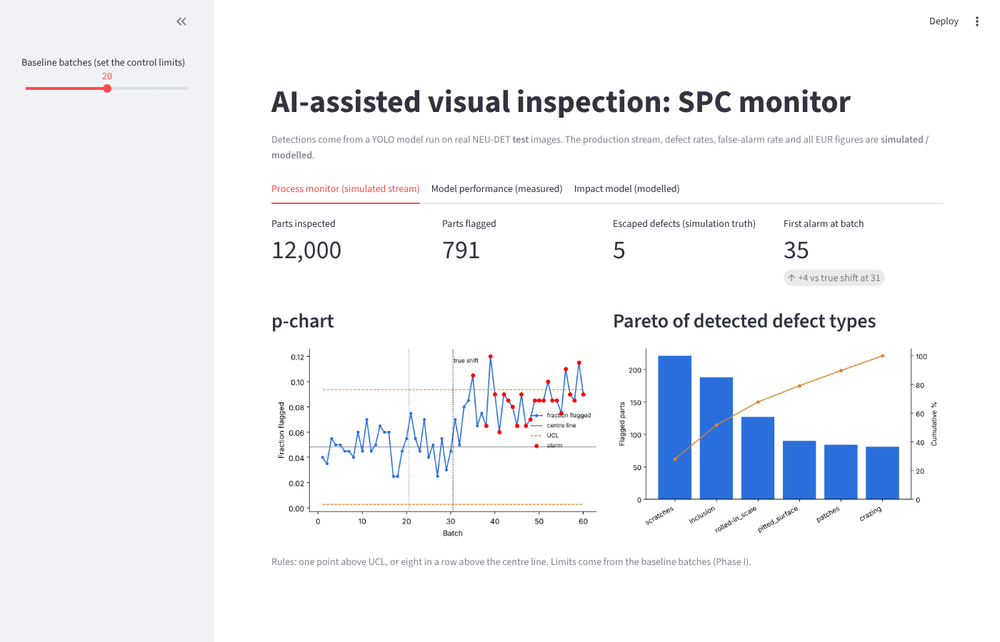
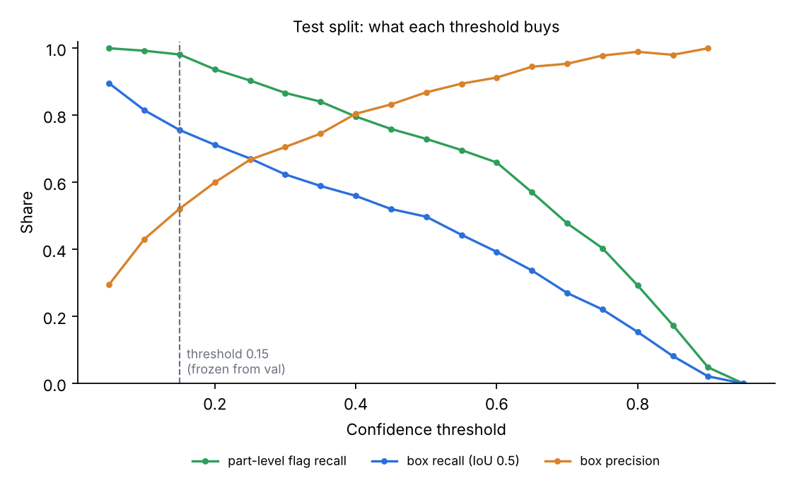
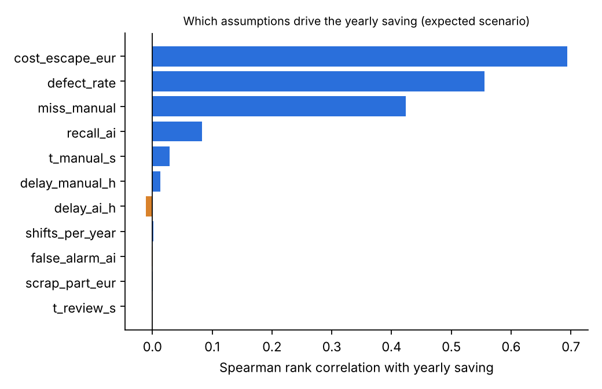

# AI-assisted visual inspection: defect detection + SPC monitoring + impact model

Detect surface defects on hot-rolled steel with YOLO11n, feed the detections into a p-chart / Pareto
dashboard, and model what that could mean for inspection effort and escaped defects.

> **Read this first.** The detector is evaluated on a real public dataset (NEU-DET). The production
> line, defect rates, false-alarm rate and every EUR figure are **simulated or assumed**. Nothing here
> was measured on a real production line. Treat the EUR output as a sensitivity tool, not a result.



## What was measured, simulated and assumed

| Part | Status | Source |
| --- | --- | --- |
| Detector quality (mAP, recall, class accuracy) | **Measured** on 270 held-out NEU-DET images | `results/test_metrics.json` |
| Part-level flag recall, with 95% interval | **Measured** (bootstrap over the test images) | `results/bootstrap_flag_recall.csv` |
| Production stream, process shift (3% to 7% defect rate) | **Simulated** | `src/config.py` |
| Human inspector miss rate (20%, range 10-30%) | **Assumed** | `src/config.py` |
| AI false-alarm rate on good parts (2%) | **Assumed**: cannot be measured on NEU-DET (see limitations) | `src/config.py` |
| Costs, volumes, labour rate, escape cost | **Assumed** | `src/config.py` |

## Results

**Detector** (YOLO11n, 224 px, 40 epochs, trained on CPU in 47 min; 1,260 train / 270 val / 270 test images,
stratified by class, seed 42). The confidence threshold (0.15) was chosen on the validation split only, as
the highest threshold with part-level flag recall of at least 0.98. The test split was then scored once at that
frozen threshold. Re-running the test evaluation from the saved weights reproduced all 36 stored metrics exactly.

| Metric (test, 270 images, 611 boxes) | Value |
| --- | --- |
| mAP50 / mAP50-95 | 0.740 / 0.435 |
| Part-level flag recall (at least 1 box on a defective part) | **0.981** (95% CI 0.963 to 0.996); 5 of 270 parts missed |
| Box recall at IoU 0.5 / box precision | 0.756 / 0.521 |
| False boxes per image | 1.57 |
| Image-level class accuracy, YOLO top-1 box | 0.974 (263 / 270) |
| Image-level class accuracy, SVM baseline (LBP + HOG) | 0.963 (260 / 270) |
| Inference speed | about 13 ms per image on 2 CPU cores |

Per-class results at the frozen threshold:

| Class | Box recall | AP50 |
| --- | --- | --- |
| crazing | 0.44 | 0.48 |
| inclusion | 0.81 | 0.75 |
| patches | 0.89 | 0.92 |
| pitted_surface | 0.82 | 0.85 |
| rolled-in_scale | 0.63 | 0.48 |
| scratches | 0.94 | 0.96 |



**SPC simulation** (3,000 runs per strategy; 200-part batches; the defect rate shifts from 3% to 7% at batch 31;
control limits from the first 20 batches; alarm on one point above UCL or eight in a row above the centre line).
Delay is the number of batches from the shift to the first alarm.

| Inspection strategy | Mean delay (batches) | Median | 90th percentile | Never alarmed | False alarm before the shift |
| --- | --- | --- | --- | --- | --- |
| AI screens every part | 1.9 | 1 | 5 | 0% | 6.3% |
| Human inspects every part (assumed 20% miss) | 1.9 | 1 | 5 | 0% | 7.2% |
| Human samples 20 parts per batch | 10.7 | 7 | 30 | 10.7% | 15.0% |

**Impact model** (20,000 Monte Carlo runs, AI-assisted vs 100% manual inspection, 5,000 parts per day, all
inputs assumed except AI recall). Expected scenario uses the measured recall. The pessimistic scenario cuts
recall by 15 points and raises the assumed false-alarm rate to 2-10%.

| Modelled output | Expected (5th / median / 95th) | Pessimistic (5th / median / 95th) |
| --- | --- | --- |
| Inspection hours saved per day | 11.7 / 16.7 / 23.3 | 11.1 / 16.1 / 22.7 |
| Escaped defects avoided per day | 19.1 / 36.7 / 68.2 | -8.1 / 6.3 / 23.8 |
| Total saving per year, k EUR | 612 / 1,387 / 3,182 | -202 / 303 / 1,080 |
| Share of runs with a positive saving | 100% | 84.6% |

Break-even AI recall, with every other input at its modal value, is **0.78**. The assumed human recall is 0.80 and
the measured AI part-level recall is 0.981.



## Limitations that matter

1. **False alarms on good parts are unknown.** Every NEU-DET image contains a defect, so there are no good
   images to measure false alarms on. At the chosen threshold the model already produces 1.57 false boxes
   per defective image. The 2% good-part false-alarm rate is an assumption and may be optimistic.
2. **YOLO is not better than a simple baseline at naming the defect.** Image-level accuracy is 97.4% (YOLO) vs
   96.3% (SVM): a 3-image difference on 270 images, not meaningful. What YOLO adds is localisation (boxes) and a
   usable flag/no-flag decision.
3. **Crazing and rolled-in scale are weak** (AP50 about 0.48). Four of the five missed parts are crazing.
4. **The modelled saving is driven by assumptions, not by the detector.** The three largest drivers are the
   assumed cost of an escaped defect, the assumed defect rate and the assumed human miss rate. Measured AI recall
   has a small effect. Do not quote the EUR figures as results.
5. **No speed advantage over full manual inspection.** The p-chart reacts to the simulated shift as fast with the
   AI as with 100% human inspection, so modelled scrap avoided is zero in the median. The advantage is against
   sampling inspection, and in labour hours.
6. **One training run.** One model size and one image size were trained, with no hyperparameter search or ablation.
   The detector is not tuned.
7. **Public, clean, 200x200 grayscale images** from one steel type. Expect lower performance on a real line.

## Reproduce

```bash
pip install -r requirements.txt
make all            # data, split, SVM baseline, train, evaluate, SPC simulation, impact model (about 1 h on CPU)
make dashboard      # streamlit run app/dashboard.py
make test-units     # unit tests (IoU, matching, class parsing, p-chart)
```

The trained weights are in `models/best.pt` (5.5 MB). To re-evaluate without training:

```bash
make prepare
make val  WEIGHTS=models/best.pt
make test WEIGHTS=models/best.pt
```

**Static dashboard (for Netlify or any static host).** Streamlit needs a Python server, which Netlify does not
run. `make static` (or `python scripts/build_static.py`) builds `web/index.html`, a self-contained copy of the
dashboard generated from the same `results/` files (same numbers, same simulated/modelled labels, no external
scripts). The JavaScript p-chart was checked against `src/spc.py` for every baseline setting on the slider.
On Netlify: base directory `cv-inspection`, no build command, publish directory `web` (set in `netlify.toml`).
It shows the saved results only; it does not run the model.

Free options: everything runs on a laptop CPU. A free Google Colab GPU should shorten training (not tested here).

## Layout

```
src/        prepare_data, baseline_svm, train_yolo, evaluate, detection_delay, make_stream, impact_model, make_figures
src/config.py   every assumption in one file
app/dashboard.py   Streamlit app: process monitor, model performance, impact model
scripts/get_data.sh   fetches NEU-DET at a pinned commit (not redistributed here)
scripts/build_static.py   builds the static dashboard in web/ (what Netlify serves)
results/    metrics, sweeps, simulation outputs, figures
models/     best.pt
tests/      unit tests
```

## CV wording that the results support

- Trained a YOLO11n steel-surface defect detector on NEU-DET (1,800 images, 6 classes, stratified 70/15/15 split):
  mAP50 0.74 on held-out images, and 98% of defective parts flagged (95% CI 96-99.6%) at a threshold fixed on the
  validation split.
- Benchmarked it against an LBP + HOG SVM baseline: image-level accuracy was comparable (97.4% vs 96.3%), so the
  gain is localisation, not classification.
- Built a Streamlit SPC dashboard (p-chart, Pareto) and a Monte Carlo inspection-cost model; in a simulated line,
  a 3% to 7% defect-rate shift was detected in 1.9 batches on average with AI screening vs 10.7 with sampling
  inspection (assumption-based simulation).

Do not claim "deployed", "production" or a EUR saving.

## Data and licence

Images and boxes are the NEU surface defect database (K. Song and Y. Yan, Northeastern University; Applied
Surface Science 285 (2013) 858-864; check the citation details against the original page before publishing).
`scripts/get_data.sh` downloads a public GitHub copy at a pinned commit. Check the original page's terms before use
beyond coursework or research. The dataset is not included in this repository. Training uses
[Ultralytics](https://github.com/ultralytics/ultralytics) (AGPL-3.0).
